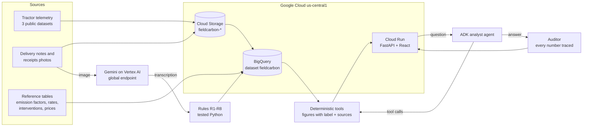

# FieldCarbon

**Where a farm-machinery fleet wastes fuel, what to change, and how sure we are. Every figure traceable.**

FieldCarbon is a desktop web app for agricultural contractors and co-operatives that run tractors across
many client farms. It shows fuel use and emissions by machine, job, field and client, checks the fuel
paperwork against the fuel log, finds waste, and ranks what to change with honest confidence levels.

Built for the Google Cloud AI Builder Cup 2026 (Sustainability & Social Impact track).

> **Demo data: illustrative.** The fleet is built from three real public tractor datasets plus clearly
> labelled synthetic records (clients, fuel deliveries, delivery-note images). Results are not advice
> for a specific business.

**Live demo:** TODO (Cloud Run URL) · **Video:** TODO · **Deck:** TODO

## Why it is different

**Uncertainty is the product.** Fleet fuel totals are solid; splits by job, client and the effect of
each change are less certain, and FieldCarbon says so.

- **Every figure carries a label**, shown as text: `measured` (telemetry, metered fuel), `allocated`
  (split by rules) or `estimated` (standard rates or published ranges).
- **Every figure is traceable** to its sources, emission factor (with version and year) and calculation.
- **Gemini never does the maths.** It reads documents, plans and explains. Every number comes from
  tested Python or BigQuery SQL, and an auditor checks that each number in an answer matches a tool output.
- **Savings are ranges** from published sources; every recommendation cites its evidence.
- **"What would improve this answer?"** A deterministic sensitivity analysis names the one missing data
  item that would most narrow the uncertainty.

## What it does

| Screen | What the fleet manager sees |
|---|---|
| Overview | Fleet fuel, CO2e (well-to-wheel, UK GHG Conversion Factors 2025) and cost, by site and month |
| Sites, Jobs, Clients | The same job compared across machines (L/ha, L/h, idle share); emissions per client farm |
| Fuel control | Depot deliveries vs dispenses vs fuel burned; **delivery notes read by Gemini, checked against the fuel log** |
| Opportunities, What if | Ranked interventions with cost, litres saved, payback range and evidence |
| Reports | A traceable report a contractor can share with clients and buyers |

## Gemini on Vertex AI

| Role | What it does | Status |
|---|---|---|
| **Document reading** | `gemini-3.5-flash` (multimodal) transcribes fuel receipts and tanker delivery notes, including handwritten, blurred, crumpled and skewed photos, into a fixed JSON schema. Rules R1–R8 then decide what counts ([rules](docs/receipt_validation_rules.md)); raw and validated rows are kept in BigQuery for provenance | **Done**: 38 documents read |
| **Fleet analyst agent** | Google ADK agent (`backend/agent/fleet_agent.py`) on `gemini-3.5-flash` that turns a question into calls to the deterministic tools and explains the result in plain language, in the question's language. Ask it in the web app (Ask the analyst); it shows which tools it looked at | **Done**: 21 eval questions, 100% right tools |
| **Auditor** | Strict, unit- and rounding-aware check that every number in an answer traces to a tool output. In the agent: an answer with an untraceable number is rewritten once, and if it still fails it carries a visible "check needed" note | **Done**, wired into the agent |
| **Client carbon statement** | Reports → one client farm: fuel, CO2e, CO2e per hectare and per job, cost and the top operations, all from code. Gemini writes a short summary in English, German, Spanish or Hindi; the auditor checks every number and label, one rewrite, then standard wording ("Audited by code" / "Standard wording" badge). Prints on one A4 page | **Done**: tests with a stub model; live check pending |

**Cost of reading documents** (token counts recorded by Vertex AI for each reading): 38 documents used
114,120 tokens, about 3,000 per document (about 80% of the output side is the model's thinking).
TODO: dollar cost at current Vertex AI pricing.

## Evaluation

`python -m evals.run_all` writes [`evals/results/summary.md`](evals/results/summary.md):

| Evaluation | Result |
|---|---|
| Tool eval cases | 32 of 32 pass |
| Figures with a confidence label and sources | 100% of 673 |
| Planted fuel problems found (A1–A3) | 3 of 3 |
| Gemini reading accuracy, 24 farm receipts (every field) | 100% |
| Gemini reading accuracy, 14 fleet delivery notes (every field) | 100% |
| Receipts-only ranges containing the telemetry truth | 8 of 12 jobs (64% of litres) |
| Agent (21 questions): right tools / every number traced / figures with a label / ideas citing their source | 100% / 100% / 100% / 100% |

How to read these honestly:
- **Agent scores include one automatic rewrite:** 8 of 21 first answers missed a label, a source, rounding or a
  traced number and were rewritten once, with the gaps named by the same deterministic checks the
  harness scores. Gemini varies between runs, so a re-run can score a little lower; an answer whose
  numbers still do not trace carries a visible "Check needed" note. 16,905 tokens per question.
- The documents are synthetic images we rendered (with damage effects), so 100% shows the pipeline
  works; it is not a claim about every real-world receipt.
- **Receipts-only vs telemetry:** the same real farm was estimated from fuel receipts alone (standard
  fuel-use rates, no telemetry) and compared with its measured telemetry. 8 of 12 job types fell inside
  the estimated ranges: receipts give a usable first picture, and telemetry is what makes it precise.

## Architecture



- **Engine:** BigQuery (reference, input and telemetry tables; calculated views; BigQuery GIS for
  fields) and tested Python. Every figure follows one contract: `{value, unit, label, how, source_ids, low, high}`.
- **App:** FastAPI backend and React + Vite + Tailwind frontend in one Cloud Run service.
- **Region:** data and services in `us-central1`; Gemini uses Vertex AI's `global` endpoint, where
  `gemini-3.5-flash` is offered. Only synthetic documents and demo questions are sent to it.

## Repository layout

```
backend/agent/       auditor (faithfulness), agent run recording
backend/tools/       one module per tool; every figure carries a label and sources
backend/receipts/    validation rules R1-R8 for read documents
backend/emissions/   BigQuery DDL and views
backend/api/         FastAPI endpoints
frontend/            React desktop app
data/fleet/          the illustrative fleet (see data/fleet/README.md)
data/synthetic/      generators for receipt and delivery-note images, with ground truth
data/reference/      emission factors, fuel-use rates, interventions, prices, sources
evals/               eval cases, harness, results
infra/               BigQuery / Cloud Storage loaders (dry run by default)
tests/               pytest for all deterministic logic
```

## Setup

Requires Python 3.12 or later and Node.js.

```bash
python -m venv .venv
.venv/Scripts/python -m pip install -r requirements-dev.txt   # Windows; use .venv/bin/python on macOS/Linux
.venv/Scripts/python -m pytest -q
.venv/Scripts/python -m evals.run_all
```

Run locally (CSV mode, no cloud needed): start the API with
`.venv/Scripts/python -m uvicorn backend.api.main:app --port 8080`, then in `frontend/` run `npm install`
and `npm run dev`, and open http://localhost:5173.

Rebuild the data from the public sources (optional; downloads are checksum-verified into the gitignored
`data/raw/`): `data/prep/download_tum.py`, `data/prep/prepare_tum.py`, `data/prep/download_fleet.py`,
then `python -m backend.fleet.build`. The preparation reads only CSV files from the dataset zips and never
loads the `.pkl` files they also contain.

Re-reading the documents with Gemini needs a Google Cloud project with Vertex AI and Application Default
Credentials: `python infra/run_receipts.py --farm fleet --model gemini-3.5-flash --location global`
(dry run; add `--apply`). Stored readings are reused, so this is not needed to run the app.

Deploy: one container (`Dockerfile`) builds the frontend and serves it from the API. `requirements.txt` holds the
runtime dependencies only. The Cloud Run commands are in [infra/deploy.md](infra/deploy.md).

## Data sources and licences

| Source | Used for | Licence |
|---|---|---|
| TUM Agricultural Load Cycles (Götz, 2025), [doi:10.5281/zenodo.14619787](https://doi.org/10.5281/zenodo.14619787) | Site 1: 5 tractors, arable (telemetry) | CC BY 4.0 |
| Rossi & Alemanno, tractor performances in vineyard operations (Mendeley Data) | Site 2: vineyard jobs | CC BY 4.0 |
| Dana, Ozener & Tellioglu, Tümosan tillage CAN bus data (Mendeley Data) | Site 3: tillage jobs | CC BY 4.0 |
| UK Government GHG Conversion Factors 2025 (DESNZ) | Emission factors (well-to-wheel) | Open Government Licence v3.0 |
| Iowa State University Extension A3-27 (rev. 2026); Purdue Extension AE-110 (1980) | Fuel-use rates per operation | Cited, not redistributed |
| Defra UK Agricultural Market Monitoring Group reports | Red diesel prices | Open Government Licence v3.0 |
| Peer-reviewed, extension, thesis and manufacturer sources | Intervention effects | Cited, not redistributed |

Full source list with derivations: [`data/reference/sources.md`](data/reference/sources.md).

**Attribution.** Götz, K. (2025). *Agricultural Load Cycles: Tractor Mission Profiles From Recorded GNSS
and CAN Bus Data* [Data set]. Zenodo. https://doi.org/10.5281/zenodo.14619787; article: Götz K., Kusuma A.,
Dörfler A., Lienkamp M. (2025), *Data in Brief* 60, 111494. TODO: full citations for the vineyard and
tillage datasets.

**Changes made:** data aggregated by job, machine and field; brand names removed; sentinel values and
frozen logger stretches excluded (reported, not counted); dates shifted or assigned; fictional clients,
operator pseudonyms, depots and deliveries added; no coordinates published.

**Limitations:** the sites are in Germany, Italy and Turkey, but the app uses UK emission factors and
prices and US fuel-use rates; this is stated in every report. The fleet's company structure is invented.
